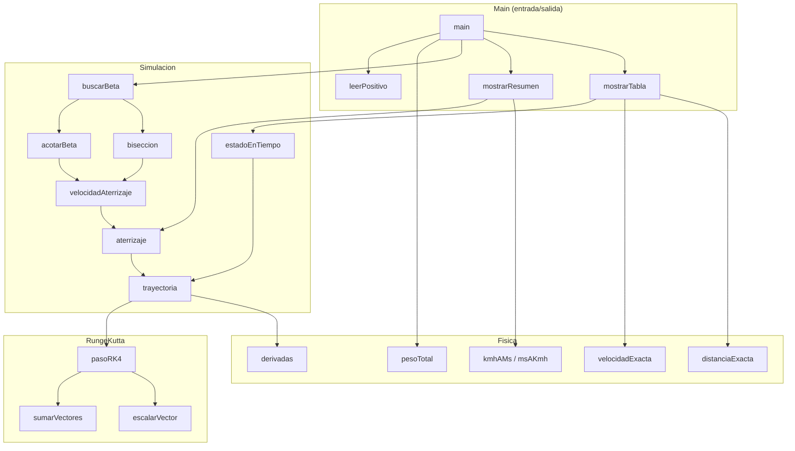

# Especificación técnica: caída amortiguada en paradigma funcional

Este documento describe el diseño del programa **independiente del lenguaje** (parte 1) y los
detalles de su implementación en Haskell y Scheme (parte 2). El diseño de la parte 1 es la
plantilla que siguen las dos versiones: ambas tienen los mismos módulos, las mismas funciones
y los mismos nombres (en Scheme se escriben con guiones, por ejemplo `pasoRK4` → `paso-rk4`).

---

# Parte 1: diseño funcional

## 1. El problema

Un paracaidista salta desde el reposo con el paracaídas ya abierto. El aire ejerce una fuerza
hacia arriba proporcional a la velocidad, `R = β·v`. Se quiere conocer:

1. la velocidad `v(t)` durante la caída,
2. la distancia recorrida `x(t)`,
3. el valor de `β` que hace que una persona de 80 kg con 50 kg de equipo, saltando desde
   1 500 m, llegue al suelo a unos **8 km/h**. Este valor lo debe **encontrar el algoritmo**.

El programa recibe tres datos del usuario: **peso del paracaidista**, **peso del equipo** y
**altura del salto**.

## 2. Modelo matemático

### 2.1 Unidades

Todo se trabaja en el Sistema Internacional:

| Magnitud | Símbolo | Unidad |
|---|---|---|
| Tiempo | t | s |
| Distancia recorrida (hacia abajo) | x | m |
| Velocidad (hacia abajo) | v | m/s |
| Aceleración de la gravedad | g = 9.81 | m/s² |
| Peso total (fuerza) | W | N |
| Constante de resistencia | β | N·s/m = kg/s |

El usuario da los "pesos" en kilogramos, como en el enunciado ("una persona de 80 kg de
peso"). El programa los suma y los convierte a fuerza: **W = (m_paracaidista + m_equipo)·g**.
Para el caso del enunciado, W = 130 · 9.81 = 1 275.3 N.

### 2.2 Ecuaciones

Por la segunda ley de Newton, con `m = W/g`:

```
(W/g)·dv/dt = W − β·v        con v(0) = 0
dx/dt = v                    con x(0) = 0
```

Para resolverlo con Runge-Kutta se escribe como un **sistema** de la forma `y' = f(t, y)`,
donde el estado es el vector `y = [x, v]`:

```
f(t, [x, v]) = [ v ,  g − (β·g/W)·v ]
```

### 2.3 Solución exacta (analítica)

El enunciado deduce las soluciones exactas. El programa las usa **solo para comparar** y
comprobar que Runge-Kutta da resultados correctos:

```
v(t) = (W/β)·(1 − e^(−β·g·t/W))
x(t) = (W/β)·t + (W²/(β²·g))·e^(−β·g·t/W) − W²/(β²·g)
```

Cuando `t` crece, `v(t)` tiende a `W/β`, la **velocidad límite**.

## 3. Algoritmo

### 3.1 Runge-Kutta de cuarto orden

Es la fórmula del enunciado ([Burden85], p. 248), aplicada a vectores. Dado el estado
`(tᵢ, wᵢ)` y el paso `h`:

```
k1 = h · f(tᵢ,       wᵢ)
k2 = h · f(tᵢ + h/2, wᵢ + k1/2)
k3 = h · f(tᵢ + h/2, wᵢ + k2/2)
k4 = h · f(tᵢ + h,   wᵢ + k3)
wᵢ₊₁ = wᵢ + (k1 + 2·k2 + 2·k3 + k4)/6
tᵢ₊₁ = tᵢ + h
```

Como `w` y las `k` son vectores, "sumar" y "multiplicar por un número" se hacen elemento por
elemento. Así, la misma función sirve para cualquier sistema de ecuaciones: Runge-Kutta **no
sabe nada de paracaidistas**.

### 3.2 Simular hasta tocar el suelo

El enunciado plantea Runge-Kutta en un intervalo fijo `[a, b]` con `N` pasos. Aquí no se
conoce `b`: es justamente el momento en que el paracaidista llega al suelo. Por eso se parte
de `(0, [0, 0])` y se avanza paso a paso **hasta que la distancia recorrida alcanza la
altura del salto**. Ese estado es el **aterrizaje**, y de él se leen el tiempo de caída y la
velocidad de llegada.

Se usa un paso fijo **h = 0.05 s**. Con ese paso, y para el β del problema (≈ 574 kg/s), la
diferencia entre Runge-Kutta y la solución exacta es menor que 10⁻⁴ m/s en la velocidad y que
10⁻⁴ m en la distancia (se comprueba en las pruebas). Frente a una velocidad de 2.22 m/s es
un error de 0.001 %, despreciable. Un paso más pequeño daría todavía más precisión, pero cada
simulación tardaría proporcionalmente más, y la búsqueda de β hace unas 40 simulaciones.

### 3.3 Encontrar β

Mientras más grande es β, más frena el paracaídas y más lento se llega al suelo. Es decir, la
velocidad de aterrizaje **disminuye** al aumentar β. Eso permite buscar β en dos fases:

1. **Acotar:** empezar con β = 1 y duplicarlo (1, 2, 4, 8, …) hasta que la velocidad de
   aterrizaje sea menor o igual que la deseada. Entonces el β buscado está entre `β/2` y `β`.
2. **Bisección:** partir el intervalo a la mitad, quedarse con la mitad donde está la
   respuesta, y repetir hasta que el intervalo mida menos de **10⁻⁶ kg/s**.

Cada evaluación de "velocidad de aterrizaje para un β" es una simulación completa con
Runge-Kutta. Así, β se encuentra **experimentalmente con el programa**, como pide el
enunciado, sin usar la fórmula de la velocidad límite.

¿Por qué acotar duplicando en vez de fijar un intervalo como [0, 10 000]? Porque no hace
falta adivinar un límite, y porque un β exageradamente grande hace que el paso h = 0.05 s
sea demasiado grande para el método (Runge-Kutta se vuelve inestable). Duplicando, el
límite superior nunca pasa del doble de la respuesta.

### 3.4 Resultado esperado

Para 80 kg + 50 kg desde 1 500 m:

| Resultado | Valor aproximado |
|---|---|
| β encontrado | 573.885 kg/s |
| Tiempo de caída | 675.25 s |
| Velocidad de aterrizaje | 2.2222 m/s = 8.00 km/h |

β coincide con `W / v_objetivo = 1275.3 / 2.2222`. Tiene sentido: desde 1 500 m el
paracaidista alcanza su velocidad límite en menos de un segundo, así que llega al suelo a esa
velocidad límite.

## 4. Diseño de módulos

El programa se divide en cuatro módulos. Cada uno tiene una sola responsabilidad (alta
cohesión) y depende solo de lo que necesita (bajo acoplamiento):

| Módulo | Responsabilidad | Depende de |
|---|---|---|
| `Fisica` | Constantes, unidades, ecuaciones del modelo y solución exacta | (nada) |
| `RungeKutta` | Un paso del método RK4 para cualquier sistema | (nada) |
| `Simulacion` | Simular la caída y buscar β | `Fisica`, `RungeKutta` |
| `Main` | Leer los datos, validarlos y mostrar resultados | `Fisica`, `Simulacion` |

Solo `Main` hace entrada/salida. Los otros tres módulos son **funciones puras**: con los
mismos datos siempre devuelven lo mismo y no modifican nada. Esto es lo central del paradigma
funcional y es lo que permite probarlas fácilmente.

### 4.1 Diagrama de composición de funciones

Cada flecha `A → B` significa "A usa a B".



### 4.2 Flujo de datos

```
datos del usuario (masa paracaidista, masa equipo, altura)
        │
        ▼
pesoTotal ──► W
        │
        ▼
buscarBeta W altura velocidadObjetivo ──► β
        │
        ├──► aterrizaje β W altura ──► (tiempo de caída, [altura, velocidad final])
        │
        └──► estadoEnTiempo β W t  (para cada t de la tabla)
             comparado con velocidadExacta / distanciaExacta
```

## 5. Firmas de las funciones

Notación: `Vector` es una lista de números; `Estado` es el par `(t, [x, v])`.

### Fisica

| Función | Firma | Qué hace |
|---|---|---|
| `gravedad` | `Número` | 9.81 m/s² |
| `pesoTotal` | `masaParacaidista → masaEquipo → W` | Suma las masas y las convierte a newtons |
| `kmhAMs` | `km/h → m/s` | Divide entre 3.6 |
| `msAKmh` | `m/s → km/h` | Multiplica por 3.6 |
| `velocidadObjetivo` | `Número` | 8 km/h expresados en m/s |
| `derivadas` | `β → W → t → [x, v] → [dx/dt, dv/dt]` | La función `f(t, y)` del sistema |
| `velocidadExacta` | `β → W → t → v` | Solución analítica de `v(t)` |
| `distanciaExacta` | `β → W → t → x` | Solución analítica de `x(t)` |

### RungeKutta

| Función | Firma | Qué hace |
|---|---|---|
| `sumarVectores` | `Vector → Vector → Vector` | Suma elemento por elemento |
| `escalarVector` | `Número → Vector → Vector` | Multiplica cada elemento por un número |
| `pasoRK4` | `f → h → Estado → Estado` | Avanza un paso de tamaño `h` |

### Simulacion

| Función | Firma | Qué hace |
|---|---|---|
| `pasoTiempo` | `Número` | h = 0.05 s |
| `estadoInicial` | `Estado` | `(0, [0, 0])`: en reposo al inicio |
| `trayectoria` | `β → W → [Estado]` | Todos los estados de la caída, paso a paso |
| `aterrizaje` | `β → W → altura → Estado` | Primer estado con `x ≥ altura` |
| `velocidadAterrizaje` | `β → W → altura → v` | Velocidad en el estado de aterrizaje |
| `estadoEnTiempo` | `β → W → t → Estado` | Estado después de `t/h` pasos (para la tabla) |
| `acotarBeta` | `W → altura → vObjetivo → β → β` | Duplica β hasta pasarse de la velocidad deseada |
| `biseccion` | `W → altura → vObjetivo → βmin → βmax → β` | Reduce el intervalo hasta la tolerancia |
| `buscarBeta` | `W → altura → vObjetivo → β` | Une las dos fases anteriores |

### Main

| Función | Qué hace |
|---|---|
| `leerPositivo` | Muestra un mensaje y lee un número; si no es un número mayor que 0, lo vuelve a pedir |
| `mostrarResumen` | Imprime β, tiempo de caída y velocidad de aterrizaje (m/s y km/h) |
| `mostrarTabla` | Imprime `t`, `v` y `x` por Runge-Kutta y exactos en tiempos de muestra |
| `main` | Pide los tres datos, calcula y muestra los resultados |

Tiempos de muestra de la tabla: 0, 0.1, 0.2, 0.5, 1, 2, 5, 10, 20, 50, 100, 200, 500, 1 000,
… (solo los anteriores al aterrizaje). Se eligieron así para ver tanto el primer segundo,
donde la velocidad cambia rápido, como el resto de la caída, donde ya es casi constante.

## 6. Pseudocódigo funcional

Sin ciclos ni variables que cambien: las repeticiones se expresan con **recursión** y los
resultados se construyen como valores nuevos.

```
derivadas(β, W, t, [x, v]) =
    [ v, g − β·g·v / W ]

pasoRK4(f, h, (t, w)) =
    sea k1 = h · f(t, w)
        k2 = h · f(t + h/2, w + k1/2)
        k3 = h · f(t + h/2, w + k2/2)
        k4 = h · f(t + h,   w + k3)
    en  (t + h, w + (k1 + 2·k2 + 2·k3 + k4)/6)

aterrizaje(β, W, altura) =
    avanzar(estadoInicial)
    donde avanzar((t, [x, v])) =
        si x ≥ altura entonces (t, [x, v])
        si no avanzar(pasoRK4(derivadas(β, W), h, (t, [x, v])))

velocidadAterrizaje(β, W, altura) =
    la v de aterrizaje(β, W, altura)

acotarBeta(W, altura, vObj, β) =
    si velocidadAterrizaje(β, W, altura) ≤ vObj entonces β
    si no acotarBeta(W, altura, vObj, 2·β)

biseccion(W, altura, vObj, βmin, βmax) =
    si βmax − βmin < tolerancia entonces βmax
    si no
        sea βmedio = (βmin + βmax)/2
        si velocidadAterrizaje(βmedio, W, altura) > vObj
            entonces biseccion(W, altura, vObj, βmedio, βmax)   -- frena poco: β más grande
            si no    biseccion(W, altura, vObj, βmin, βmedio)   -- frena mucho: β más chico

buscarBeta(W, altura, vObj) =
    sea βmax = acotarBeta(W, altura, vObj, 1)
    en  biseccion(W, altura, vObj, βmax/2, βmax)
```

`biseccion` devuelve `βmax` y no el punto medio porque `βmax` siempre cumple la condición
(aterriza a `vObj` o más lento), así que es la respuesta segura.

## 7. Validación de entradas

Los tres datos deben ser **números mayores que 0**. Si el usuario escribe texto, 0 o un número
negativo, el programa muestra un aviso y vuelve a pedir el dato. No hacen falta más
restricciones: para cualquier altura positiva existe un β que da la velocidad deseada, porque
la velocidad de aterrizaje baja hacia 0 a medida que β crece.

---

# Parte 2: implementación

> Se completa al terminar las versiones en Haskell y Scheme.

## Referencias

- [Spiegel83] Spiegel, Murray. *Ecuaciones Diferenciales Aplicadas*. Prentice-Hall, 1983, pp. 76-78.
- [Burden85] Burden, Richard L.; Faires, J. Douglas. *Análisis Numérico*. Grupo Editorial
  Iberoamérica, 1985, p. 248.
