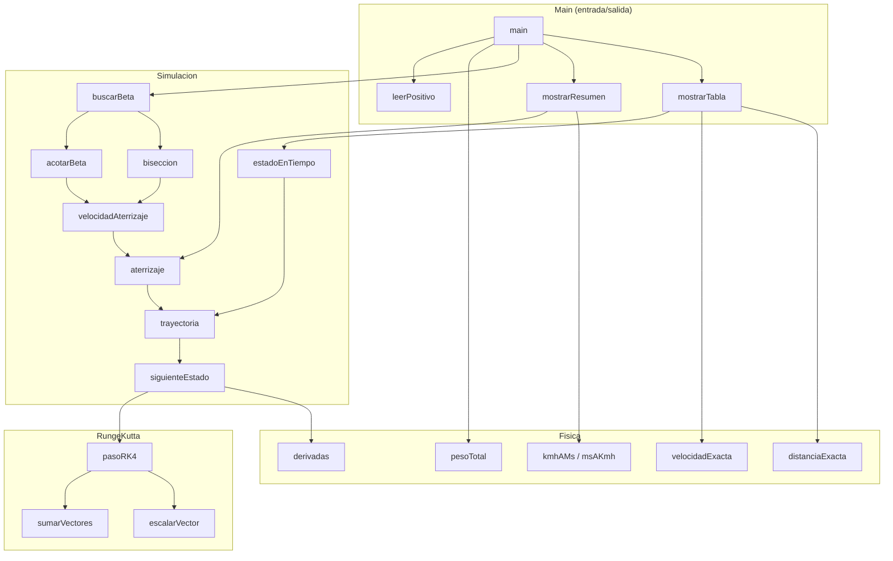

# Especificación técnica: caída amortiguada en paradigma funcional

Este documento describe el diseño del programa **independiente del lenguaje** (parte 1) y los
detalles de su implementación en Haskell y Scheme (parte 2). El diseño de la parte 1 es la
plantilla que siguen las dos versiones: ambas tienen los mismos módulos, las mismas funciones
y los mismos nombres (en Scheme se escriben con guiones, por ejemplo `pasoRK4` → `paso-rk4`).

---

# Parte 1: diseño funcional

## 1. El problema

Un paracaidista salta desde el reposo con el paracaídas ya abierto. El aire ejerce una fuerza
hacia arriba proporcional a la velocidad, `R = β·v`. Se quiere conocer:

1. la velocidad `v(t)` durante la caída,
2. la distancia recorrida `x(t)`,
3. el valor de `β` que hace que una persona de 80 kg con 50 kg de equipo, saltando desde
   1 500 m, llegue al suelo a unos **8 km/h**. Este valor lo debe **encontrar el algoritmo**.

El programa recibe tres datos del usuario: **peso del paracaidista**, **peso del equipo** y
**altura del salto**.

## 2. Modelo matemático

### 2.1 Unidades

Todo se trabaja en el Sistema Internacional:

| Magnitud | Símbolo | Unidad |
|---|---|---|
| Tiempo | t | s |
| Distancia recorrida (hacia abajo) | x | m |
| Velocidad (hacia abajo) | v | m/s |
| Aceleración de la gravedad | g = 9.81 | m/s² |
| Peso total (fuerza) | W | N |
| Constante de resistencia | β | N·s/m = kg/s |

El usuario da los "pesos" en kilogramos, como en el enunciado ("una persona de 80 kg de
peso"). El programa los suma y los convierte a fuerza: **W = (m_paracaidista + m_equipo)·g**.
Para el caso del enunciado, W = 130 · 9.81 = 1 275.3 N.

### 2.2 Ecuaciones

Por la segunda ley de Newton, con `m = W/g`:

```
(W/g)·dv/dt = W − β·v        con v(0) = 0
dx/dt = v                    con x(0) = 0
```

Para resolverlo con Runge-Kutta se escribe como un **sistema** de la forma `y' = f(t, y)`,
donde el estado es el vector `y = [x, v]`:

```
f(t, [x, v]) = [ v ,  g − (β·g/W)·v ]
```

### 2.3 Solución exacta (analítica)

El enunciado deduce las soluciones exactas. El programa las usa **solo para comparar** y
comprobar que Runge-Kutta da resultados correctos:

```
v(t) = (W/β)·(1 − e^(−β·g·t/W))
x(t) = (W/β)·t + (W²/(β²·g))·e^(−β·g·t/W) − W²/(β²·g)
```

Cuando `t` crece, `v(t)` tiende a `W/β`, la **velocidad límite**.

## 3. Algoritmo

### 3.1 Runge-Kutta de cuarto orden

Es la fórmula del enunciado ([Burden85], p. 248), aplicada a vectores. Dado el estado
`(tᵢ, wᵢ)` y el paso `h`:

```
k1 = h · f(tᵢ,       wᵢ)
k2 = h · f(tᵢ + h/2, wᵢ + k1/2)
k3 = h · f(tᵢ + h/2, wᵢ + k2/2)
k4 = h · f(tᵢ + h,   wᵢ + k3)
wᵢ₊₁ = wᵢ + (k1 + 2·k2 + 2·k3 + k4)/6
tᵢ₊₁ = tᵢ + h
```

Como `w` y las `k` son vectores, "sumar" y "multiplicar por un número" se hacen elemento por
elemento. Así, la misma función sirve para cualquier sistema de ecuaciones: Runge-Kutta **no
sabe nada de paracaidistas**.

### 3.2 Simular hasta tocar el suelo

El enunciado plantea Runge-Kutta en un intervalo fijo `[a, b]` con `N` pasos. Aquí no se
conoce `b`: es justamente el momento en que el paracaidista llega al suelo. Por eso se parte
de `(0, [0, 0])` y se avanza paso a paso **hasta que la distancia recorrida alcanza la
altura del salto**. Ese estado es el **aterrizaje**, y de él se leen el tiempo de caída y la
velocidad de llegada.

Se usa un paso fijo **h = 0.05 s**. Con ese paso, y para el β del problema (≈ 574 kg/s), la
diferencia entre Runge-Kutta y la solución exacta es menor que 10⁻⁴ m/s en la velocidad y que
10⁻⁴ m en la distancia (se comprueba en las pruebas). Frente a una velocidad de 2.22 m/s es
un error de 0.001 %, despreciable. Un paso más pequeño daría todavía más precisión, pero cada
simulación tardaría proporcionalmente más, y la búsqueda de β hace unas 40 simulaciones.

### 3.3 Encontrar β

Mientras más grande es β, más frena el paracaídas y más lento se llega al suelo. Es decir, la
velocidad de aterrizaje **disminuye** al aumentar β. Eso permite buscar β en dos fases:

1. **Acotar:** empezar con β = 1 y duplicarlo (1, 2, 4, 8, …) hasta que la velocidad de
   aterrizaje sea menor o igual que la deseada. A ese valor le llamamos `βmax`: el β buscado
   está entre 0 y `βmax`.
2. **Bisección:** partir el intervalo `[0, βmax]` a la mitad, quedarse con la mitad donde
   está la respuesta, y repetir hasta que el intervalo mida menos de **10⁻⁶ kg/s**.

Se biseca desde 0 (y no desde `βmax/2`) para cubrir también saltos muy bajos, de menos de
unos 25 cm, donde incluso β = 1 ya basta. Cuesta solo una simulación más.

Cada evaluación de "velocidad de aterrizaje para un β" es una simulación completa con
Runge-Kutta. Así, β se encuentra **experimentalmente con el programa**, como pide el
enunciado, sin usar la fórmula de la velocidad límite.

¿Por qué acotar duplicando en vez de fijar un intervalo como [0, 10 000]? Porque no hace
falta adivinar un límite, y porque un β exageradamente grande hace que el paso h = 0.05 s
sea demasiado grande para el método (Runge-Kutta se vuelve inestable). Duplicando, el
límite superior nunca pasa del doble de la respuesta.

### 3.4 Resultado esperado

Para 80 kg + 50 kg desde 1 500 m:

| Resultado | Valor aproximado |
|---|---|
| β encontrado | 573.885 kg/s |
| Tiempo de caída | 675.25 s |
| Velocidad de aterrizaje | 2.2222 m/s = 8.00 km/h |
| Simulaciones necesarias | 11 para acotar (β = 1, 2, …, 1024) + 30 de bisección |

β coincide con `W / v_objetivo = 1275.3 / 2.2222`. Tiene sentido: desde 1 500 m el
paracaidista alcanza su velocidad límite en menos de un segundo, así que llega al suelo a esa
velocidad límite.

## 4. Diseño de módulos

El programa se divide en cuatro módulos. Cada uno tiene una sola responsabilidad (alta
cohesión) y depende solo de lo que necesita (bajo acoplamiento):

| Módulo | Responsabilidad | Depende de |
|---|---|---|
| `Fisica` | Constantes, unidades, ecuaciones del modelo y solución exacta | (nada) |
| `RungeKutta` | Un paso del método RK4 para cualquier sistema | (nada) |
| `Simulacion` | Simular la caída y buscar β | `Fisica`, `RungeKutta` |
| `Main` | Leer los datos, validarlos y mostrar resultados | `Fisica`, `Simulacion` |

Solo `Main` hace entrada/salida. Los otros tres módulos son **funciones puras**: con los
mismos datos siempre devuelven lo mismo y no modifican nada. Esto es lo central del paradigma
funcional y es lo que permite probarlas fácilmente.

### 4.1 Diagrama de composición de funciones

Cada flecha `A → B` significa "A usa a B".



### 4.2 Flujo de datos

```
datos del usuario (masa paracaidista, masa equipo, altura)
        │
        ▼
pesoTotal ──► W
        │
        ▼
buscarBeta W altura velocidadObjetivo ──► β
        │
        ├──► aterrizaje β W altura ──► (tiempo de caída, [altura, velocidad final])
        │
        └──► estadoEnTiempo β W t  (para cada t de la tabla)
             comparado con velocidadExacta / distanciaExacta
```

## 5. Firmas de las funciones

Notación: `Vector` es una lista de números; `Estado` es el par `(t, [x, v])`.

### Fisica

| Función | Firma | Qué hace |
|---|---|---|
| `gravedad` | `Número` | 9.81 m/s² |
| `pesoTotal` | `masaParacaidista → masaEquipo → W` | Suma las masas y las convierte a newtons |
| `kmhAMs` | `km/h → m/s` | Divide entre 3.6 |
| `msAKmh` | `m/s → km/h` | Multiplica por 3.6 |
| `velocidadObjetivo` | `Número` | 8 km/h expresados en m/s |
| `derivadas` | `β → W → t → [x, v] → [dx/dt, dv/dt]` | La función `f(t, y)` del sistema |
| `velocidadExacta` | `β → W → t → v` | Solución analítica de `v(t)` |
| `distanciaExacta` | `β → W → t → x` | Solución analítica de `x(t)` |

### RungeKutta

| Función | Firma | Qué hace |
|---|---|---|
| `sumarVectores` | `Vector → Vector → Vector` | Suma elemento por elemento |
| `escalarVector` | `Número → Vector → Vector` | Multiplica cada elemento por un número |
| `pasoRK4` | `f → h → Estado → Estado` | Avanza un paso de tamaño `h` |

### Simulacion

| Función | Firma | Qué hace |
|---|---|---|
| `pasoTiempo` | `Número` | h = 0.05 s |
| `toleranciaBeta` | `Número` | 10⁻⁶ kg/s: precisión con la que se busca β |
| `estadoInicial` | `Estado` | `(0, [0, 0])`: en reposo al inicio |
| `tiempo`, `distancia`, `velocidad` | `Estado → Número` | Leen `t`, `x` o `v` de un estado |
| `siguienteEstado` | `β → W → Estado → Estado` | El estado un paso `h` después (un paso de RK4) |
| `trayectoria` | `β → W → [Estado]` | Todos los estados de la caída, paso a paso |
| `aterrizaje` | `β → W → altura → Estado` | Primer estado con `x ≥ altura` |
| `velocidadAterrizaje` | `β → W → altura → v` | Velocidad en el estado de aterrizaje |
| `estadoEnTiempo` | `β → W → t → Estado` | Estado después de `t/h` pasos (para la tabla) |
| `acotarBeta` | `W → altura → vObjetivo → β → β` | Duplica β hasta pasarse de la velocidad deseada |
| `biseccion` | `W → altura → vObjetivo → βmin → βmax → β` | Reduce el intervalo hasta la tolerancia |
| `buscarBeta` | `W → altura → vObjetivo → β` | Une las dos fases anteriores |

### Main

| Función | Qué hace |
|---|---|
| `leerPositivo` | Muestra un mensaje y lee un número; si no es un número mayor que 0, lo vuelve a pedir |
| `mostrarResumen` | Imprime β, tiempo de caída y velocidad de aterrizaje (m/s y km/h) |
| `mostrarTabla` | Imprime `t`, `v` y `x` por Runge-Kutta y exactos en tiempos de muestra |
| `main` | Pide los tres datos, calcula y muestra los resultados |

Tiempos de muestra de la tabla: 0, 0.1, 0.2, 0.5, 1, 2, 5, 10, 20, 50, 100, 200, 500, 1 000,
… (solo los anteriores al aterrizaje). Se eligieron así para ver tanto el primer segundo,
donde la velocidad cambia rápido, como el resto de la caída, donde ya es casi constante.

## 6. Pseudocódigo funcional

Sin ciclos ni variables que cambien: las repeticiones se expresan con **recursión** y los
resultados se construyen como valores nuevos.

```
derivadas(β, W, t, [x, v]) =
    [ v, g − β·g·v / W ]

pasoRK4(f, h, (t, w)) =
    sea k1 = h · f(t, w)
        k2 = h · f(t + h/2, w + k1/2)
        k3 = h · f(t + h/2, w + k2/2)
        k4 = h · f(t + h,   w + k3)
    en  (t + h, w + (k1 + 2·k2 + 2·k3 + k4)/6)

aterrizaje(β, W, altura) =
    avanzar(estadoInicial)
    donde avanzar((t, [x, v])) =
        si x ≥ altura entonces (t, [x, v])
        si no avanzar(pasoRK4(derivadas(β, W), h, (t, [x, v])))

velocidadAterrizaje(β, W, altura) =
    la v de aterrizaje(β, W, altura)

acotarBeta(W, altura, vObj, β) =
    si velocidadAterrizaje(β, W, altura) ≤ vObj entonces β
    si no acotarBeta(W, altura, vObj, 2·β)

biseccion(W, altura, vObj, βmin, βmax) =
    si βmax − βmin < tolerancia entonces βmax
    si no
        sea βmedio = (βmin + βmax)/2
        si velocidadAterrizaje(βmedio, W, altura) > vObj
            entonces biseccion(W, altura, vObj, βmedio, βmax)   -- frena poco: β más grande
            si no    biseccion(W, altura, vObj, βmin, βmedio)   -- frena mucho: β más chico

buscarBeta(W, altura, vObj) =
    sea βmax = acotarBeta(W, altura, vObj, 1)
    en  biseccion(W, altura, vObj, 0, βmax)
```

`biseccion` devuelve `βmax` y no el punto medio porque `βmax` siempre cumple la condición
(aterriza a `vObj` o más lento), así que es la respuesta segura.

## 7. Validación de entradas

Los tres datos deben ser **números finitos mayores que 0**. Si el usuario escribe texto, 0, un
número negativo o infinito, el programa muestra un aviso y vuelve a pedir el dato. Si la
entrada se termina antes de tener los tres datos, el programa termina con un mensaje. No hacen falta más
restricciones: para cualquier altura positiva existe un β que da la velocidad deseada, porque
la velocidad de aterrizaje baja hacia 0 a medida que β crece.

---

# Parte 2: implementación

## 8. Herramientas

| | Haskell | Scheme |
|---|---|---|
| Implementación | GHC 9.6.7 | GNU Guile 3.0.11 |
| Ejecución | Compilado (`ghc -dynamic -O1 -Wall`) | Guile compila cada módulo al usarlo y guarda el resultado en `~/.cache/guile` |
| Pruebas | Lista propia de pruebas `(nombre, Bool)` | SRFI-64 (incluida en Guile) |
| Bibliotecas externas | Ninguna (solo `base`) | Ninguna |

El `Makefile` tiene los comandos: `make run-haskell`, `make run-scheme`, `make test`,
`make clean`.

## 9. Correspondencia de nombres

Las dos versiones implementan las funciones de la sección 5. En Haskell se usa *camelCase*;
en Scheme, palabras separadas por guiones y `?` al final de las funciones que responden sí
o no.

| Módulo | Haskell | Scheme |
|---|---|---|
| Fisica | `Fisica.hs` | `fisica.scm` |
| | `pesoTotal` | `peso-total` |
| | `kmhAMs`, `msAKmh` | `kmh-a-ms`, `ms-a-kmh` |
| | `velocidadObjetivo` | `velocidad-objetivo` |
| | `derivadas` | `derivadas` |
| | `velocidadExacta`, `distanciaExacta` | `velocidad-exacta`, `distancia-exacta` |
| RungeKutta | `RungeKutta.hs` | `runge-kutta.scm` |
| | `sumarVectores`, `escalarVector` | `sumar-vectores`, `escalar-vector` |
| | `pasoRK4` | `paso-rk4` |
| Simulacion | `Simulacion.hs` | `simulacion.scm` |
| | `pasoTiempo`, `toleranciaBeta`, `estadoInicial` | `paso-tiempo`, `tolerancia-beta`, `estado-inicial` |
| | `tiempo`, `distancia`, `velocidad` | `tiempo`, `distancia`, `velocidad` |
| | `siguienteEstado` | `siguiente-estado` |
| | `trayectoria` | (no existe, ver sección 11) |
| | `aterrizaje`, `velocidadAterrizaje` | `aterrizaje`, `velocidad-aterrizaje` |
| | `estadoEnTiempo` | `estado-en-tiempo` |
| | `acotarBeta`, `biseccion`, `buscarBeta` | `acotar-beta`, `biseccion`, `buscar-beta` |
| Main | `Main.hs` | `main.scm` |
| | `interpretarPositivo`, `leerPositivo` | `interpretar-positivo`, `leer-positivo` |
| | `resumen`, `filaTabla`, `tabla` | `resumen`, `fila-tabla`, `tabla` |

## 10. Versión en Haskell

### Representación de los datos

```haskell
type Vector = [Double]           -- por ejemplo [x, v]
type Estado = (Double, Vector)   -- (t, [x, v])
```

Se usan sinónimos de tipo (`type`) para que las firmas se lean como el diseño
(`pasoRK4 :: (Double -> Vector -> Vector) -> Double -> Estado -> Estado`), sin definir tipos
nuevos.

### Elementos del lenguaje usados

- **Firmas de tipo** en todas las funciones. GHC comprueba al compilar que cada función
  recibe y devuelve lo que dice el diseño.
- **Currificación:** `derivadas beta peso` ya es una función de `t` y `[x, v]`, lista para
  pasarla a `pasoRK4` sin escribir una función nueva.
- **Evaluación perezosa:** `trayectoria = iterate (siguienteEstado beta peso) estadoInicial`
  es una lista infinita. `aterrizaje` toma de ella el primer estado que ya llegó al suelo
  (`head (dropWhile noHaLlegado ...)`), y solo se calculan los estados hasta ese punto.
- **Guardas (`|`)** en `acotarBeta` y `biseccion`, con la misma forma que el pseudocódigo.
- **`where`** para nombrar resultados intermedios (`k1`…`k4`, `betaMedio`, `final`).
- **`zipWith4`** para combinar los cuatro vectores `k` con la fórmula `(a + 2b + 2c + d)/6`.
- **`Maybe`** en `interpretarPositivo`: el tipo obliga a tratar el caso "dato inválido".
- **`printf` devolviendo `String`:** las líneas del resumen y de la tabla se arman con
  funciones puras, y solo `main` las imprime.

### Detalles

- `hSetEncoding stdout utf8` al inicio de `main`, para que los acentos se impriman bien en
  cualquier terminal.
- Antes de cada `getLine` se revisa `isEOF`: si la entrada viene de un archivo y se acaba, el
  programa termina con un mensaje en lugar de un error de Haskell.
- `derivadas` tiene un caso con `error` para cuando el vector no es `[x, v]`. Nunca debería
  ocurrir, pero así todos los patrones están cubiertos y `-Wall` no da advertencias.

## 11. Versión en Scheme

### Representación de los datos

```scheme
(x v)          ; un vector es una lista de números
(t (x v))      ; un estado es una lista con el tiempo y el vector
```

Las funciones `tiempo`, `distancia` y `velocidad` leen cada parte de un estado, para no
repetir `car` y `cadr` por todo el código.

### Elementos del lenguaje usados

- **Módulos** con `define-module` y `#:export`: cada archivo declara qué funciones ofrece, igual
  que la lista de exportación de un módulo de Haskell.
- **Closures:** `(derivadas beta peso)` devuelve un `lambda` que "recuerda" `beta` y `peso`.
  Es la forma explícita de hacer en Scheme la currificación que Haskell hace sola.
- **Recursión de cola** con *let con nombre* (`let avanzar`): `aterrizaje` y
  `estado-en-tiempo` avanzan paso a paso llamándose a sí mismas como última operación. Scheme
  garantiza que eso no gasta pila, así que los 13 500 pasos de una caída no son problema.
- **`map` con varias listas:** `(map (lambda (a b c d) ...) k1 k2 k3 k4)` hace lo mismo que
  `zipWith4` en Haskell.
- **`cond`** en `biseccion` y `leer-positivo`, con la misma forma que el pseudocódigo.
- **`format`** de `(ice-9 format)` para los decimales (`~,3f`), y `read-line` de
  `(ice-9 rdelim)` para leer una línea.

### Diferencia con el diseño: no hay `trayectoria`

Scheme evalúa todo de inmediato (evaluación **estricta**). Una lista infinita como la de
Haskell nunca terminaría de construirse. En su lugar:

- `siguiente-estado` avanza un paso;
- `aterrizaje` repite `siguiente-estado` **hasta** que la distancia alcanza la altura;
- `estado-en-tiempo` repite `siguiente-estado` **n veces**.

Guile ofrece *streams* perezosos (SRFI-41), con los que se podría imitar la lista infinita,
pero se descartaron: agregan un concepto nuevo solo para copiar a Haskell, y la recursión de
cola es la forma natural de repetir en Scheme.

## 12. Comparación entre las dos versiones

| Aspecto | Haskell | Scheme |
|---|---|---|
| Evaluación | Perezosa: calcula solo lo que se usa | Estricta: calcula todo en el momento |
| Tipos | Estáticos, revisados al compilar | Dinámicos, revisados al ejecutar |
| Repetir pasos | Lista infinita (`iterate`) + `dropWhile` / `!!` | Recursión de cola (`let avanzar`) |
| Funciones de varios argumentos | Currificadas automáticamente | Se devuelve un `lambda` a mano |
| Combinar vectores | `zipWith`, `zipWith4` | `map` con varias listas |
| Dato inválido | `Maybe Double` (`Nothing`) | El número o `#f` |
| Pruebas | Lista propia `(nombre, Bool)` | SRFI-64 |
| Tiempo para el caso del enunciado | ≈ 0.3 s | ≈ 1.9 s |

Haskell es más rápido porque GHC conoce los tipos al compilar (todo es `Double`) y optimiza
con `-O1`. Guile crea listas nuevas en cada paso de Runge-Kutta y revisa los tipos al
ejecutar. Para este problema ambos tiempos son aceptables.

## 13. Precisión y limitaciones

- **Paso fijo.** Con h = 0.05 s el error de Runge-Kutta frente a la solución exacta es menor
  que 10⁻⁴ (sección 3.2). En la tabla se nota solo en t = 0.20 s, en el cuarto decimal.
- **Aterrizaje.** Se toma el primer estado con `x ≥ altura`, sin interpolar entre pasos. Por
  eso la tabla muestra x = 1 500.052 m: el último paso se pasó 5 cm. El tiempo de caída
  tiene un error de a lo sumo un paso (0.05 s). La velocidad de aterrizaje casi no se ve
  afectada, porque en ese momento ya es constante.
- **Tabla.** Los tiempos de muestra llegan hasta 10 000 s. En una caída más larga se ven menos
  filas, pero la fila del aterrizaje siempre aparece.
- **Entradas extremas.** Para cualquier altura positiva existe un β que cumple, y la búsqueda
  lo encuentra (incluso con 0.1 m, donde β es casi 0). Masas o alturas absurdas (por ejemplo,
  millones de metros) solo hacen la simulación más lenta.

## 14. Verificación

1. **Pruebas automáticas** (`make test`): 25 en cada lenguaje, las mismas en los dos.
   - Física: peso, conversiones, ecuaciones en reposo y a velocidad límite, solución exacta.
   - Runge-Kutta: suma y escala de vectores; un paso con `y' = y` contra el valor calculado
     a mano (1.1051708333); simulación contra la solución exacta con β = 10 (error < 10⁻⁶) y
     con β = 574 (error < 10⁻⁴).
   - Simulación: estado inicial, avance de h por paso, distancia que nunca disminuye,
     aterrizaje sin pasarse más de un paso, β mayor frena más, β del enunciado = 573.885,
     aterrizaje a 8 km/h en dos casos distintos, altura muy baja.
2. **Comparación entre lenguajes:** la salida de los dos programas es idéntica carácter por
   carácter (sin contar el título) para 80/50/1500, 72.5/15.5/3000 y 60/20/800.
3. **Validación de entradas** probada a mano: texto, 0, negativos, `80 kg`, infinito, espacios
   alrededor del número, decimales y fin de la entrada.

## 15. Respuesta a la pregunta de investigación

Para una persona de 80 kg con 50 kg de equipo que salta desde 1 500 m, el programa encuentra
**β = 573.885 kg/s**. Con ese valor llega al suelo a los 675.25 s a 2.2222 m/s (**8.00 km/h**).

El valor coincide con `W / v_objetivo = 1275.3 N / 2.2222 m/s`, la velocidad límite de la
solución analítica. Esto confirma el resultado numérico: con β tan grande, el paracaidista
alcanza la velocidad límite en menos de 2 segundos y cae casi todo el trayecto a velocidad
constante.

## Referencias

- [Spiegel83] Spiegel, Murray. *Ecuaciones Diferenciales Aplicadas*. Prentice-Hall, 1983, pp. 76-78.
- [Burden85] Burden, Richard L.; Faires, J. Douglas. *Análisis Numérico*. Grupo Editorial
  Iberoamérica, 1985, p. 248.
